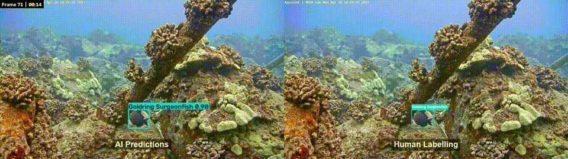
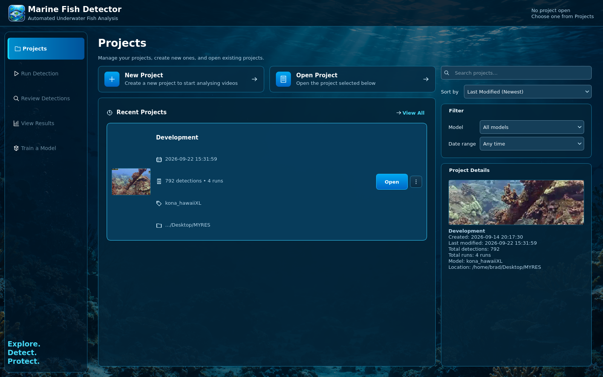
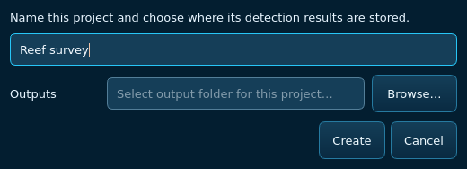
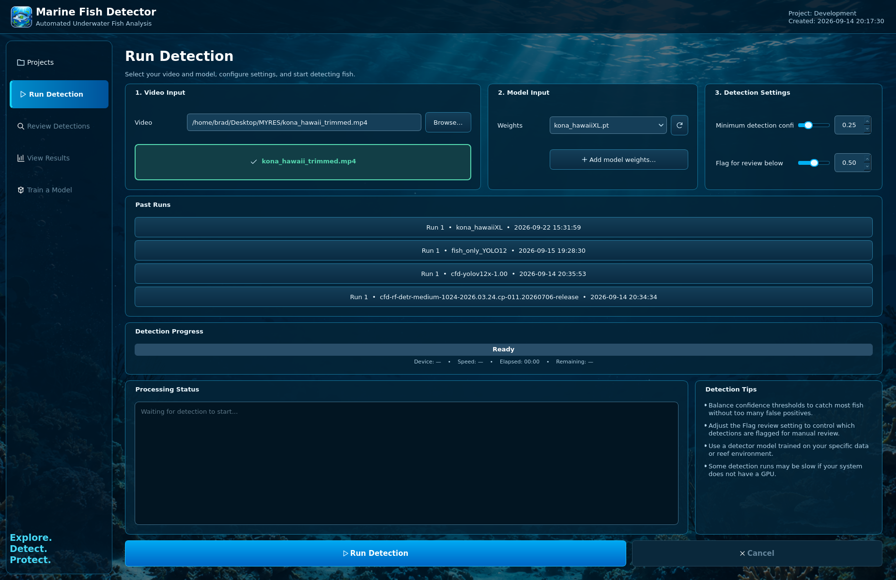
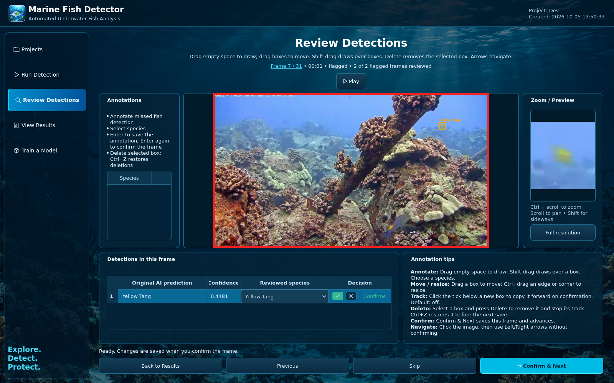
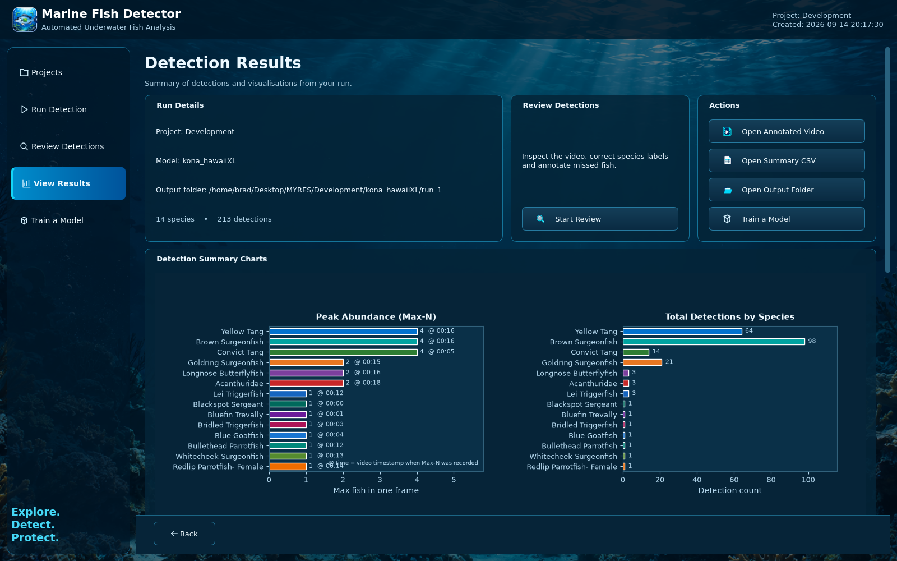
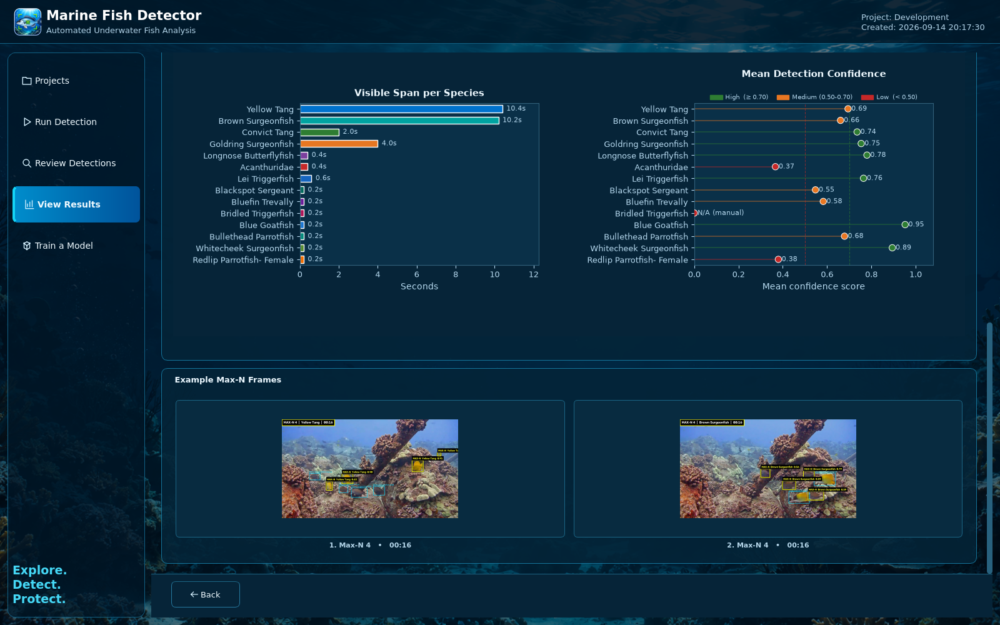

# 🐟 Marine Fish Detection and Classification GUI

A desktop application for automated marine fish detection, classification, tracking, and analysis from underwater video.


---

## Overview 

The Marine Fish Detection and Classification GUI provides an accessible graphical interface for processing underwater video using AI-driven fish detection and classification.

The application lets researchers and marine scientists use AI tools to accelerate underwater marine analysis without requiring programming experience.

Below is an example of AI-annotated underwater imagery positioned next to the ground truth, labelled by a human.

<p align="center">

</p>

### Features

- Automated fish detection and species classification
- Multi-object tracking
- Max-N abundance estimation by species
- Annotated video output
- Species-level detection summaries
- Low-confidence detection review
- Detection summary histograms and charts
- CSV result exports
- Project-based organisation of detection runs
- Support for additional compatible YOLO model weights (future support for additional AI models)

---

## App tutorial videos

Choose the tutorial that matches your starting point. Each workflow begins by creating or opening a project.

### User 1: Fish Detection

> “I have marine imagery ready to be processed. How do I use this app to detect fish and review the results?”

Follow the detection workflow: select your video and model, run detection, review the annotations, and explore the results.

<!-- <video src="./assets/Detect.mp4" controls width="800"></video>

[Watch the Fish Detection tutorial](./assets/Detect.mp4) -->
https://github.com/user-attachments/assets/818c5b37-be47-4773-8d9f-978ede435ffe


### User 2: Generate Training Data

> “I want to create AI training data for this reef. How do I annotate fish and export a dataset?”

Start in **Annotate Data**: load a video, draw and label fish, then export reviewed frames as a YOLO training dataset.

<!-- <video src="./assets/Annotate.mp4" controls width="800"></video>

[Watch the Generate Training Data tutorial](./assets/Annotate.mp4) -->
https://github.com/user-attachments/assets/1e629fb4-20c2-45b1-82e4-2d2c73295168


### User 3: Train an AI Model

> “I already have annotated AI training data. How can I use it to train a fish detection model?”

Start in **Train a Model**: load your YOLO dataset’s `data.yaml`, validate it, choose your training settings, and train a model to use in the app.

<!-- <video src="./assets/Train_Model.mp4" controls width="800"></video>

[Watch the Train an AI Model tutorial](./assets/Train_Model.mp4) -->
https://github.com/user-attachments/assets/dadffcb2-fd3d-4065-80d7-ab51183c1109

---

## Quick Start

**Platforms:** Windows, Linux (Ubuntu 24.04), and Apple Silicon macOS (`osx-arm64`, pending real-Mac validation). Intel Macs are not included. Allow **at least 15 GB of free disk space** for the app, dependencies, and download cache, plus space for videos and results. The Linux environment alone uses approximately 8 GB; requirements vary by platform.

Choose your platform: [ **Windows**](#windows) · [ **Linux**](#linux-and-macos) · [ **macOS**](#linux-and-macos)

Install Pixi once, then download and run the installer for your platform. It installs Git and Git LFS, downloads the app into `~/MarineApps/Marine-Fish-Detection-and-Classification-GUI`, installs its dependencies, and creates the desktop icon. Existing installation folders are left untouched; choose a different directory if one already exists.

<a id="windows"></a>
###  Windows

**1. Install Pixi.** Open PowerShell:

```powershell
powershell -ExecutionPolicy Bypass -Command "irm -useb https://pixi.sh/install.ps1 | iex"
```

**2. Close and reopen PowerShell, then download and run the installer:**

```powershell
Invoke-WebRequest -Uri 'https://raw.githubusercontent.com/Brad420169/Marine-Fish-Detection-and-Classification-GUI/main/installation.ps1' -OutFile installation.ps1
powershell -NoProfile -ExecutionPolicy Bypass -File .\installation.ps1
```

For a different installation directory, use `powershell -NoProfile -ExecutionPolicy Bypass -File .\installation.ps1 -InstallDir 'D:\MarineApps'` instead of the last command. You can also download [installation.ps1](installation.ps1) manually and run it from the folder where you saved it.

The installer creates shortcuts on your actual Desktop (including a redirected OneDrive Desktop) and in the Start menu. Execution-policy bypass applies only to that PowerShell process.

<a id="linux-and-macos"></a>
###  Linux and  macOS

- **Linux:** Ubuntu 24.04 on x86_64 is the reference platform. If `curl` is missing, install it with `sudo apt update && sudo apt install -y curl` (or your distribution's package manager).
- **macOS:** use macOS 13 or newer on an Apple Silicon (M-series) Mac with a native ARM64 terminal, not Rosetta. Intel Macs are not configured. Real-Mac validation is still pending. Detection initially uses **CPU**; YOLO training selects **MPS** when available and needs separate testing.

**1. Install Pixi.** Open Terminal:

```bash
curl -fsSL https://pixi.sh/install.sh | bash
```

**2. Close and reopen Terminal, then download and run the installer:**

```bash
curl -fsSL https://raw.githubusercontent.com/Brad420169/Marine-Fish-Detection-and-Classification-GUI/main/installation.sh -o installation.sh && bash installation.sh
```

If you download [installation.sh](installation.sh) manually, open Terminal in the folder where you saved it and run:

```bash
bash installation.sh
```

For a different installation directory, run `INSTALL_DIR="$HOME/My Marine Apps" bash installation.sh`. The installer automatically selects the Linux or macOS shortcut script.

`--locked` installs the versions recorded in `pixi.lock` without updating it. Pixi selects the dependencies for your operating system automatically.

- **Linux:** the script creates a desktop icon and application-menu entry, including support for localized desktop folder names. If prompted, right-click the icon and choose **Allow Launching**. Some desktop environments display launchers only in the application menu.
- **macOS:** the script creates **Marine Fish Detection GUI.app** on the Desktop with its icon. If macOS blocks the unsigned launcher, right-click it and choose **Open**. The script does not disable Gatekeeper or remove quarantine attributes.

**First Mac test:** open Terminal and run (adjust the path if you chose a different installation directory):

```bash
cd "$HOME/MarineApps/Marine-Fish-Detection-and-Classification-GUI"
pixi run --locked GUI
```

This keeps errors visible in Terminal. Create a project, load a short video, run each model type you use (YOLO `.pt` and/or RF-DETR `.pth`), review detections, and open results and output files. Separately test YOLO training if needed, then close the app and test the desktop launcher. CPU detection can be slow.

### Launch and pin the app

Double-click **Marine Fish Detection GUI** on your Desktop. Keep the repository in its installation directory: the shortcut points to it. If you move it, rerun the corresponding shortcut script from the new location. You can also rerun just the shortcut script for an existing installation; there is no need to clone again.

- **Windows:** find the app in Start, right-click, and choose **Pin to taskbar** (possibly under **More**).
- **Linux (GNOME/Ubuntu):** open **Show Applications**, right-click **Marine Fish Detection GUI**, and choose **Pin to Dash** or **Add to Favorites**.
- **macOS:** right-click the running app's Dock icon and choose **Options → Keep in Dock**.

## Using the Application

The screenshots below show the current desktop GUI with an existing example project. Your project names, paths, models, and detection counts will differ. Click a screenshot to view it at full size.

### 1. Create or open a project

Start on **Projects**. Click **New Project**, enter a name, choose an output folder, and click **Create**. Detection runs are organised under that project.



The creation dialog asks for both a project name and an output location:



To continue an existing project, select it under **Recent Projects** and click **Open Project**, or use the **Open** button on its card. Use the search, sort, and filter controls on the right to find projects. **View All** expands the recent-project list.

### 2. Select a video and model

Opening a project takes you to **Overview**. Choose any starting point:

| Starting point | Use it when | Next actions |
|---|---|---|
| **Detect Fish** | You have a video and an existing model. | Run detection, check predictions in Annotate Data, then view Results. |
| **Annotate Data** | You want to label footage manually without running a model. | Open a video, save completed frames, export a YOLO dataset, then train. |
| **Train a Model** | You already have a YOLO dataset. | Open `data.yaml`, validate it, train, evaluate, and reuse the model. |

Overview also lists saved annotation sessions, detection runs, datasets, and trained models. Use the bin beside an item to remove its project entry after confirmation; its files remain on disk. These tools remain available throughout a project; completing a detection run is not a prerequisite for annotation or training. Finish or stop background jobs before switching projects.

For the detection workflow, choose **Detect Fish**:



1. In **Video Input**, click **Browse…** or drop a video onto the dashed area.
2. In **Model Input**, choose installed model weights. Use **Add model weights…** to import compatible YOLO `.pt` or RF-DETR `.pth` weights.
3. Set the detection and review thresholds:

| Setting | What it changes |
|---|---|
| **Minimum detection confidence** | The minimum score a model detection needs to be accepted. Lower values admit more detections, including potentially more false positives. |
| **Flag for review below** | Accepted detections below this score are flagged for manual review. This does not change which detections the model accepts. |

Use either the sliders or numeric fields. The defaults are **0.25** for detection and **0.50** for review. Hover over a setting for help. Overlap sensitivity is no longer a GUI control; the run configuration uses a fixed IoU threshold of **0.80** where supported by the detector.

### 3. Run detection

Click **Run Detection** at the bottom of the page; scroll down if needed. The progress and status panels show frames processed, processing device, speed, elapsed time, and estimated time remaining. **Cancel** stops the active run.

When processing finishes, the app opens **Annotate Data**. Review the predictions before returning to Results. To reopen an existing run without reprocessing its video, click its entry under **Past Runs** on the Run Detection page. A run with saved review edits awaiting a results refresh opens in review first.

## Annotate Data

For manual work, choose **Annotate Data** in the sidebar, browse for a video or drag one into the drop area, set a frame interval, and click **Start annotating**. This creates a saved annotation session without requiring model weights. Sessions reopen at the first unfinished sampled frame. **Tools → Sessions** returns to the session list; detection runs can also be opened there.

**Tools → Frame interval** changes how far Previous, Skip, and Confirm & Next advance; playback still shows every video frame. Manual tracking switches navigation to one frame at a time so copied boxes can be checked. Saving an empty frame explicitly marks it as a background example; an unfinished frame is never exported.

**Tools → Suggest boxes** adds drafts on the current unfinished frame, using CPU inference. **Tools → Choose model** selects the weights; **Assist annotation** after training selects the new model for you. Existing boxes and completed frames are preserved. Check suggested boxes and species before saving; accepted suggestions become human-confirmed annotations, without invented tracking IDs or confidence scores.

The annotation page places the video frame in the centre, missed-fish annotations on the left, a selected-fish preview on the right, and the detection table below.



### Inspect and correct predictions

1. Select a detection in the frame or table to inspect its **Zoom / Preview** crop. **Full resolution** opens a larger view.
2. Correct its **Reviewed species** if needed.
3. Use the tick to keep a detection or the cross to reject a false positive or duplicate. Crossed rows are struck out and their boxes disappear; the tick can undo a rejection before saving.
4. Click **Confirm & Next** to save the frame's decisions and advance. Confirm frames that are already correct too.

Resolved rows are hidden from the table. Click their boxes on the image to reopen their species editor. With a box selected, press **Delete** to remove it and its visible table row immediately. This saves only that deletion, without confirming the frame. Press **Ctrl+Z** to restore the last deleted box and its row; repeated presses restore earlier deletions in reverse order. This also works after stepping to another frame. Undo history resets when you confirm a frame, save a new annotation, or reopen a run. Delete and Ctrl+Z inside a species text field retain their normal text-editing behavior. Rejecting a manual annotation deletes it when confirmed; rejecting a model detection records the rejection so refreshed statistics can exclude it.

### Play or step through the video

Click **Play** to advance through every video frame at the source frame rate; **Pause** stops on the current frame. A **bright red outline around the image** marks frames containing flagged model detections. Playback does not confirm frames or save decisions. It pauses when you start editing or leave the page, and stops at the end of the video. Slower machines may play below the source frame rate so no frames are skipped.

The **Review frames only** checkbox is temporarily hidden. **Left/Right arrow keys**, **Previous**, and **Skip** move one frame at a time without confirming it. **Confirm & Next** saves and confirms before advancing. Click the frame counter to jump to a frame number. When no video can be opened, playback is disabled and navigation uses the saved review frames. Navigation asks before discarding unconfirmed edits.

### Add missed fish

Drag a rectangle around a missed fish directly in the image. Use **Shift+drag** to draw over an existing box instead of moving it. Choose the species in the Annotations panel. **Track?** controls appear in the Annotations panel after **Enter** saves the class: click the **tick** to enable tracking, or leave the default **cross** for a single-frame box. No popup interrupts drawing. There is no Draw box button. Press **Enter** in its species field to save the annotation without advancing, or save pending boxes together with **Confirm & Next**. Use the annotation's remove button or **Ctrl+Z** to remove a pending box.

For small fish, use **Ctrl+scroll** to zoom, **scroll** to pan vertically, and **Shift+scroll** to pan sideways. Boxes are saved in the original frame coordinates regardless of zoom.

Manual annotations contribute to detection counts and Max-N after the results refresh. They do not invent model confidence scores or track IDs; mean confidence uses model detections only.

### Move boxes and track across frames

Click and drag inside an existing box to move it. Hold **Ctrl** and drag an edge to resize its width or height, or a corner to resize both. Both model boxes and manual annotations can be moved, including while zoomed in; their coordinates stay inside the frame. Click **Confirm & Next** to save position changes. Model boxes retain their original detection identity, so moving one updates the same detection in refreshed results rather than creating a duplicate.

Manual tracking copies a box forward one frame at a time:

1. Draw a box, choose its species in the Annotations panel, and press **Enter** to save it. Click the **Track?** tick in that panel to opt into tracking. The current frame stays open; there is no end-frame picker.
2. Click **Confirm & Next** to save this frame and copy the box to the next frame.
3. If the next frame already has a same-species annotation overlapping the tracked box (at least 50% intersection-over-union), that annotation carries the track instead of adding a duplicate. If a later frame has no match, manual copying resumes from the latest box. Adjust the box as needed, then confirm again to continue.
4. When the fish disappears, select its box and press **Delete** to stop tracking from that frame onward. **Ctrl+Z** restores the deletion until you confirm or save another annotation.

Playback, arrow keys, and Skip only navigate; they do not copy boxes. Copied boxes remain pending until confirmed, and the next frame is not marked reviewed. Confirming a frame again never duplicates or overwrites an existing next-frame box. Deleting a track also removes any later boxes already saved for that track; earlier frames stay intact. Existing range-based tracks remain readable, but no longer interpolate. Manual tracks have no model confidence or AI-generated track ID.

### Remove detections from a fixed area

Hold the **right mouse button and drag** a rectangle over an unwanted annotation. Model boxes whose centres fall inside that area are removed from the current and later frames of this video, regardless of predicted species. Earlier frames, manual annotations, and active tracks are preserved. Zoom and pan are supported.

**Ctrl+Z** undoes the whole area removal before you confirm or save another annotation. Removals are saved with the review CSV and apply after reopening, in refreshed results, and in dataset exports. Normal **Delete** only removes the selected annotation (or stops its track); repeated deletions no longer trigger automatic suppression.

### Return to refreshed results

Click **Back to Results** or navigate away using the sidebar to save your labelled annotations and edits automatically, even when only part of the video has been reviewed. Leaving does not confirm unfinished frames or advance tracks. Boxes without a species must be labelled or removed before leaving. For detection runs, the app refreshes saved results before opening the destination page, so charts and summaries include your changes. Manual sessions save and return to Overview without generating detection results. There is no separate **Refresh Results** button.

The refresh rebuilds `track_summary.csv`, charts, and available Max-N examples from the original predictions plus saved decisions. It also writes `reviewed_detections.csv` and preserves the initial summary as `track_summary_original.csv`. Unreviewed predictions retain their original labels. Refreshing does not rerun tracking, and repeated refreshes start from `original_detections.json` rather than accumulating changes.

Older runs without original detection data must be reprocessed before their summaries can be refreshed accurately. Missing source images can prevent individual Max-N examples from being regenerated. **Back to Results** asks “Regenerate video with updated annotations?”. Choose **Yes** to rebuild the video from the clean working source, preserving this run’s FPS, along with refreshing the CSV and plots. **No** updates the CSV and plots only; **Cancel** stays in the editor. The old video is replaced only after regeneration succeeds, and its first version is retained in `.original_video`.

## Results

Use **View Results** in the sidebar or **Back to Results** after review. The page shows the selected run, species and detection totals, output shortcuts, and summary charts.



### Open outputs

| Action | What it opens |
|---|---|
| **Open Annotated Video** | The generated video with detection boxes, species labels, and confidence scores. |
| **Open Summary CSV** | `track_summary.csv`, with species-level Max-N, timing, visible duration, track counts, detection counts, and mean confidence. |
| **Open Output Folder** | The run directory containing its generated files. |
| **Open Annotations** | The review page for this run. |
| **Train a Model** | YOLO training from a project dataset or an external `data.yaml`. |

The run directory also contains `low_confidence_review.csv` for flagged detections and saved review decisions. Output buttons are disabled when the corresponding file is unavailable.

### Charts and Max-N examples

Scroll down to see peak abundance (**Max-N**), total detections, visible span, and mean detection confidence by species. Max-N is the largest number of fish of a species visible in a single frame, rather than a count of unique fish across the whole video.



The example frames show available Max-N observations with the relevant fish highlighted. After review, the refreshed charts and examples reflect saved corrections and manual annotations.

## Train a Model

Dataset export is available from **Annotate Data → Tools → Export dataset**. Choose training and validation percentages, a new destination folder, and **Generate AI Training Data**. The remaining percentage is held out for testing. Only completed frames are exported, including explicitly confirmed empty frames. Each session currently contains one source video; its frames are split in time order. At least three completed frames and a labelled fish are required. Existing dataset directories are never overwritten.

Exported datasets appear in Overview and in the training page's project dataset selector. Click **Use in Train a Model** to continue immediately.

To start directly with an existing dataset:

1. Open **Train a Model** from Overview or the sidebar.
2. Choose a project dataset or click **Open YOLO dataset…** and select `data.yaml`.
3. Validate the dataset. The page shows its classes and train/validation/test image counts, and checks local paths and detection labels. YAML download commands and duplicate images across splits are rejected. A missing test split is allowed for training but cannot be evaluated.
4. Choose starting YOLO `.pt` weights, epochs, batch size, patience, image size, and run name. RF-DETR `.pth` weights cannot be trained with this trainer.
5. Click **Start Training** and follow the learning dashboard and log. **Stop Training** stops the process. Dataset and model inputs are locked while training or evaluation is active.
6. Use **Evaluate Test Set** after successful training to evaluate the held-out images.
7. Use **Use for detection** or **Assist annotation** to reuse the trained weights. Completed models are saved in the project Overview and can be reopened later.

Training saves weights, including `best.pt`, under the dataset's `runs` folder. Original datasets, model weights, and existing annotations remain intact.

## Updating

To update the application, close it and open PowerShell (Windows) or Terminal (Linux/macOS) in the application folder. Run each command in order and stop if one fails:

```powershell
git pull --ff-only
git lfs pull
pixi install --locked
```

## Project Structure

```text
Marine-Fish-Detection-and-Classification-GUI/
│
├── assets/             Application icons and graphics
├── models/             Marine fish detection model weights
├── scripts/            Application source code
│
├── launch_gui.bat      Windows launcher
├── pixi.toml           Environment configuration
├── pixi.lock           Locked dependency environment
├── .gitattributes      Git LFS configuration
├── .gitignore          Local/generated file exclusions
├── LICENSE             Software license
└── README.md
```

Application environments and user-created project information are generated locally and are not stored in the repository.

Detection outputs are stored in the location the user selects when creating a project.

## Adding a New AI Object/Fish Detector Model

Detection logic is isolated in `scripts/detectors.py` behind a single adapter interface, so `pipeline.py` and the GUI can remain agnostic to the model architecture. 
Adding a new model type (e.g. a different YOLO variant, DETR variant, or something else entirely) means implementing an additional Python class to support the new model type — nothing else in the codebase needs to change.

### How the adapter layer works

Every detector is a subclass of `BaseDetector` with one required method:

```python
class BaseDetector:
    kind: str = "base"

    def infer(self, frame_bgr: np.ndarray, conf: float, iou: float) -> DetectionFrame:
        raise NotImplementedError
```

`infer()` takes a single BGR video frame plus the confidence/IoU thresholds from the GUI sliders, and must return a `DetectionFrame`:

```python
@dataclass
class DetectionFrame:
    annotated: np.ndarray                       # frame with boxes/labels drawn on it
    species: list[str] = field(default_factory=list)
    confidences: list[float] = field(default_factory=list)
    xyxy: list[list[float]] = field(default_factory=list)       # [x1, y1, x2, y2] per detection
    track_ids: list[int | None] = field(default_factory=list)   # None if no tracker
```

As long as your class returns a correctly shaped `DetectionFrame`, everything downstream, such as the annotated output video, `track_summary.csv`, `low_confidence_review.csv`, the Max-N example frames, and the Results page charts, will work automatically.

### Steps to add a new model

1. **Write a new class in `detectors.py`** that subclasses `BaseDetector`:

```python
   class MyModelDetector(BaseDetector):
       kind = "mymodel"

       def __init__(self, weights_path: Path, device: str | None) -> None:
           # Load your model here, once, at startup.
           from my_model_lib import MyModel
           self.model = MyModel.load(str(weights_path), device=device)

       def infer(self, frame_bgr: np.ndarray, conf: float, iou: float) -> DetectionFrame:
           # Run inference, then map your model's output into the
           # DetectionFrame fields above. Draw boxes/labels onto a
           # copy of frame_bgr for the `annotated` field.
           ...
           return DetectionFrame(
               annotated=annotated,
               species=species,
               confidences=confidences,
               xyxy=xyxy,
               track_ids=track_ids,
           )
```

   Look at `YOLODetector` and `RFDETRDetector` in the same file as worked examples. Note how `RFDETRDetector` handles a model with no built-in tracker by attaching `supervision.ByteTrack()` manually. If your model doesn't track objects across frames either, do the same.

2. **Register the weights file extension** in the `load_detector()` factory at the bottom of `detectors.py`:

```python
   def load_detector(weights_path: Path, device: str | None) -> BaseDetector:
       suffix = weights_path.suffix.lower()
       if suffix == ".pt":
           return YOLODetector(weights_path, device=device)
       if suffix == ".pth":
           return RFDETRDetector(weights_path, device=device)
       if suffix == ".your_extension":
           return MyModelDetector(weights_path, device=device)
       raise ValueError(...)
```

   The GUI's model dropdown (`WeightsRow` in `widgets.py`) currently only globs for `*.pt` and `*.pth` files in `models/` — if your weights use a different extension, add it to the glob there too:

```python
   models = sorted(
       [*self.models_dir.glob("*.pt"), *self.models_dir.glob("*.pth"), *self.models_dir.glob("*.your_extension")]
   )
```

3. **Add any new dependencies** to `pixi.toml`, then run `pixi install` to lock them into `pixi.lock`.

4. **Drop your weights file into `models/`** (or use the "Add model weights…" button in the GUI) and select it from the Weights dropdown — the rest of the pipeline (detection loop, CSV export, Max-N frame extraction, summary charts) runs unmodified.

### Detection is slow

Processing speed depends heavily on the available hardware.

A compatible GPU can significantly improve detection performance. Systems without a compatible GPU can use CPU processing, but processing will generally be slower.

The Windows/Linux environment includes CUDA-enabled PyTorch 2.7.1 with CUDA 12.6, including support for Pascal GPUs such as the GTX 1070. A working NVIDIA driver is required. Before each run, the app checks CUDA availability and executes a small GPU operation, then explicitly passes the selected device to inference. The processing status and log show the selected GPU or the reason for CPU fallback. GPU errors during model inference are reported rather than silently restarting on the CPU.

---

## Troubleshooting

 
### `git` is not recognised / not found
Close and reopen PowerShell/Terminal. The installer installs Git and Git LFS through Pixi. If needed, run `pixi global install git git-lfs`, then check `git --version` and `git lfs version`.
 
### `pixi` is not recognised / not found
Close and reopen PowerShell/Terminal, then check:
```
pixi --version
```
**Linux/macOS:** for the default Pixi installation, run `export PATH="$HOME/.pixi/bin:$PATH"` and try again. If that works, add the same line to your shell configuration (`~/.zshrc` for the default macOS shell, or `~/.bashrc` for Bash). If Pixi was installed elsewhere, use its actual directory instead.
 
### Model files did not download
Open PowerShell/Terminal in the application folder and run:
```
git lfs install
git lfs pull
```
 
### Installation stopped partway through
The installer refuses to overwrite an existing application folder. If cloning completed, open PowerShell/Terminal in that folder and resume with:

```text
git lfs install --local
git lfs pull
pixi install --locked
```

Stop if a command fails. Once these succeed, recreate the shortcut using the command for your platform:

- **Windows:** `powershell -NoProfile -ExecutionPolicy Bypass -File .\setup\create_windows_shortcut.ps1`
- **Linux:** `bash setup/create_linux_shortcut.sh`
- **macOS:** `bash setup/create_macos_shortcut.sh`

If cloning did not complete, choose a new installation directory and rerun the installer. Do not delete an existing folder containing your projects or results. If Pixi reports an outdated lockfile, update the checkout first; do not delete `pixi.lock` to work around it.

### macOS installer rejects the platform
Run `uname -m` and `sw_vers -productVersion`. The installer requires `arm64` and macOS 13 or newer. On an M-series Mac reporting `x86_64`, close Terminal, turn off **Open using Rosetta** in Terminal's Finder **Get Info** window if enabled, and reopen it. Intel Macs are not supported by this environment.

### The application does not launch
Open PowerShell/Terminal in the application folder and run:
```
pixi install --locked
pixi run --locked GUI
```
Any startup errors will then be displayed in the terminal.
 
**Linux only:** if the desktop shortcut does not launch, rerun its setup script from the repository, then right-click the icon and choose **Allow Launching**:

```bash
bash setup/create_linux_shortcut.sh
```


## Development

The application is written in Python and uses:

- PyQt6
- Ultralytics YOLO
- PyTorch
- OpenCV
- Matplotlib
- NumPy

Pixi manages the development and runtime environment.

### Planned Features

Future development may include:

- Expanded model management
- Improved detection review and correction tools
- Additional result visualisation and analysis options

---


## Model and Dataset Attribution

The included marine fish detection models were trained using the **Kona, Hawaii Dataset**, published by ReefOSHawaii on Roboflow Universe.

**Dataset citation:**

> ReefOSHawaii. (2022). *Kona, Hawaii Dataset*. Roboflow Universe.

[Kona, Hawaii Dataset — Roboflow Universe](https://universe.roboflow.com/reefoshawaii/kona-hawaii)

The dataset is licensed under the **Creative Commons Attribution 4.0 International (CC BY 4.0) License**.

[Creative Commons Attribution 4.0 International](https://creativecommons.org/licenses/by/4.0/)

The model weights included in this repository were trained by the author of this project using the Kona, Hawaii Dataset. They are not original model weights supplied by ReefOSHawaii or Roboflow.

---

## License

The application source code is licensed under the **MIT License**. See [`LICENSE`](LICENSE) for details.

The included model weights were trained using the Kona, Hawaii Dataset described above. The underlying training dataset is provided by ReefOSHawaii under the **Creative Commons Attribution 4.0 International (CC BY 4.0) License**.

### Video frame rate

After browsing or dropping a video in **Detect Fish** or **Annotate Data**, the app reads its FPS. Keep **Original** or choose **30, 24, 15 or 5 FPS**; only lower rates are offered. A separate working video is sampled at that rate while maintaining normal playback speed. Detection output, annotation frame numbers and timestamps use the selected rate. The original file is never overwritten. Reduced-FPS working videos contain no audio.

Frames removed from a run cannot be recovered by increasing its FPS. Start a new run or annotation session and drop or browse the original video again to return to its original frame rate. Annotation’s frame interval remains a separate choice for how far the editor advances.

### Trash a project

Deleting a project from **Projects** moves its metadata and project-owned output folders to the system trash: Recycle Bin on Windows, Trash on macOS, or the desktop trash on Linux. Original videos and externally imported datasets/models outside those folders are preserved. A failed trash operation reports an error and never falls back to permanent deletion. If some folders were already moved before an error, they remain recoverable in the trash.

### Stopping training

**Stop Training** ends the current process, then automatically removes that job’s incomplete output folder (including checkpoints and plots) and temporary dataset configuration files. Failed jobs and stopping during app close use the same cleanup. Completed runs, original images, labels, dataset YAML, and source model weights are preserved. Successfully completed jobs keep their outputs and remove temporary files. Cleanup errors are shown in the training log with the affected path.
